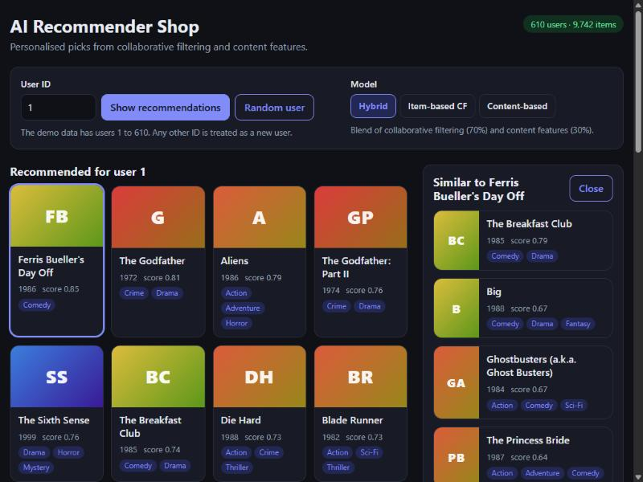
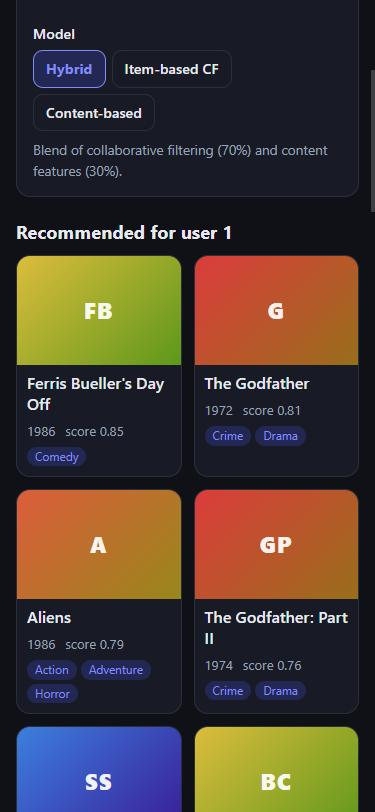

# AI Recommender Shop

[](https://github.com/KimThanhTran/ai-recommender-shop/actions/workflows/ci.yml)


A product-recommendation engine for an online store: item-based collaborative filtering, content-based filtering and a hybrid of the two, evaluated offline against a popularity baseline, served through a REST API and browsable in a React storefront.

The catalogue here is the public [MovieLens](https://grouplens.org/datasets/movielens/latest/) "latest-small" dataset (610 users, 9,742 items, 100,836 ratings). Movies stand in for products; the techniques and the evaluation are the same ones an e-commerce store would use on purchase or rating data.





*Real screenshots of the running app on the MovieLens data. The dataset has no product images, so cards show a placeholder tinted by genre.*

## Results

Chronological per-user split: each user's most recent 20% of ratings is held out, the models train on the earlier 80%, and a held-out rating of 4 stars or more counts as relevant. Top-10 lists, averaged over the 592 users who have at least one relevant held-out item. Items a user already rated are never recommended.

| Model | Precision@10 | Recall@10 | Hit rate@10 | NDCG@10 | Coverage |
| --- | --- | --- | --- | --- | --- |
| `popularity` (baseline) | 0.058 | 0.048 | 0.321 | 0.075 | 1.0% |
| `content` | 0.008 | 0.006 | 0.064 | 0.010 | 31.6% |
| `item_knn` | 0.084 | 0.078 | 0.441 | 0.104 | 6.0% |
| `hybrid` (0.7 CF + 0.3 content) | **0.090** | **0.086** | **0.456** | **0.113** | 6.2% |

*Coverage is the share of the catalogue that appears in at least one user's top-10.*

Reproduce with `python scripts/evaluate.py` (writes `results/metrics.md` and `results/metrics.json`).

**What the numbers say, and what they do not**

- Collaborative filtering clearly beats the popularity baseline: about 45% more precision and hit rate rising from 32% to 44%.
- The hybrid is ahead of item-based CF alone by a small margin. It comes from one split of a small dataset and I did not compute confidence intervals, so treat that gap as suggestive, not proven.
- Content-based filtering on its own is weak. It only sees genres, user tags and release decade, which says little about taste. It earns its place in the hybrid and for "similar items", not as a standalone ranker.
- Its coverage is the highest (31.6%) and popularity's the lowest (1.0%): popularity recommends the same few blockbusters to everyone.
- The hybrid weight (0.7) was fixed in advance, not tuned on the test split, to avoid leaking test data into the choice.

## How it works

| Model | Idea |
| --- | --- |
| `popularity` | Most-rated items first. Not personalised; the bar every other model has to clear. |
| `item_knn` | Item-item cosine similarity on the rating matrix. Similarities are shrunk towards zero when two items share few raters (so an item with one rating cannot look identical to another) and only the 50 strongest neighbours per item are kept. A user's score for an item is the similarity-weighted sum of their own ratings of its neighbours. |
| `content` | TF-IDF vectors from genres, tags and release decade. A user profile is the average of the vectors of items they rated, weighted by rating minus their mean; items are ranked by cosine similarity to it. |
| `hybrid` | Min-max scaled blend of `item_knn` and `content` scores. |

Cold start: a user with no history gets popular items (`personalised: false`). A user with very little history gets the model's picks topped up with popular items they have not rated.

## Quick start

```bash
git clone https://github.com/KimThanhTran/ai-recommender-shop.git
cd ai-recommender-shop

python -m venv .venv
source .venv/bin/activate        # Windows: .venv\Scripts\activate
pip install -r requirements-dev.txt

python scripts/download_data.py   # fetches MovieLens into ./data
python scripts/evaluate.py        # offline evaluation
python -m pytest                  # tests
uvicorn app.main:app --reload     # API on http://localhost:8000 (docs at /docs)
```

### Web interface

With the API running (above), in another terminal:

```bash
cd frontend
npm install
npm run dev                       # http://localhost:5173 (proxies /api to port 8000)
npm test                          # component tests with a mocked API
```

### Docker

```bash
python scripts/download_data.py   # the images do not contain the dataset
docker compose up --build
```

- Web interface: http://localhost:8080 (nginx serves the React build and forwards `/api/*` to the API)
- API with interactive docs: http://localhost:8000/docs

`./data` is mounted read-only into the API container.

## API

| Method | Endpoint | Description |
| --- | --- | --- |
| GET | `/health` | Status, number of users and items |
| GET | `/recommend/{user_id}?k=10&model=hybrid` | Top-k for a user. `model` is `hybrid`, `item_knn` or `content`. Unknown users get popular items. |
| GET | `/items/{item_id}/similar?k=10&model=hybrid` | "Customers also viewed": items most similar to one item |
| GET | `/items/{item_id}` | Item details |
| GET | `/popular?k=10` | Most-rated items |
| GET | `/users/{user_id}/history?limit=10` | The user's highest-rated items, to explain a recommendation |

```bash
curl "http://localhost:8000/recommend/1?k=2"
```

```json
{
  "user_id": 1,
  "model": "hybrid",
  "personalised": true,
  "items": [
    {"item_id": 2918, "title": "Ferris Bueller's Day Off (1986)", "genres": ["Comedy"], "score": 0.8469},
    {"item_id": 858, "title": "Godfather, The (1972)", "genres": ["Crime", "Drama"], "score": 0.8116}
  ]
}
```

`k` is limited to 1 to 50; invalid values return `422`, unknown items and users return `404`.

## Web interface

A small React (Vite) app in [`frontend/`](frontend/) that uses only the API above:

- Pick a user (or a random one) and a model, and see the top 12 recommendations
- "Because the user rated these highly": their own top-rated items, to explain the picks
- Click any item for "customers also viewed" (similar items from the selected model)
- New users are detected from the API response and shown popular items with an explanation (cold start)
- Loading skeletons, API-offline and error messages, keyboard-accessible controls, light and dark themes, responsive layout

12 component tests run against a mocked API.

## Project structure

```
.
├── recsys/                 # the library
│   ├── data.py             # MovieLens loading, chronological split, item text
│   ├── models.py           # popularity, item-kNN, content-based, hybrid
│   ├── metrics.py          # precision, recall, hit rate, NDCG
│   └── evaluate.py         # offline evaluation loop
├── app/                    # FastAPI service
│   ├── service.py          # business logic (fallbacks, formatting)
│   └── main.py             # routes and startup
├── frontend/               # React (Vite) web interface
│   ├── src/                # App, components, API client, tests
│   ├── Dockerfile          # build, then serve with nginx
│   └── nginx.conf          # SPA fallback and /api proxy
├── scripts/                # download_data.py, evaluate.py
├── tests/                  # 30 backend tests on a small hand-made dataset
├── docs/                   # screenshots
├── results/                # metrics from the last evaluation run
├── Dockerfile, docker-compose.yml
└── .github/workflows/ci.yml
```

## Limitations and next steps

- Offline metrics on one small public dataset do not predict business results. Real validation needs an A/B test on live traffic.
- Ratings stand in for purchases. A real store would use implicit signals (views, add-to-cart, purchases) and would need to handle new products with no interactions at all.
- The models are re-fitted at startup (about 3 seconds here); there is no incremental update and no model persistence.
- Only item-based CF is implemented. Matrix factorisation (ALS or SVD-style) and a learned ranking model are natural next experiments.
- The web interface is a recommendation browser, not a full shop: there is no cart, checkout, login or product images, and the user is chosen by ID.

## Data and licence

Data: F. Maxwell Harper and Joseph A. Konstan, *The MovieLens Datasets: History and Context*, ACM TiiS 5(4), 2015. The dataset is provided by GroupLens for research and may not be redistributed, so it is downloaded on demand and excluded from this repository and from the Docker image.

No licence file is included for the code in this repository.
